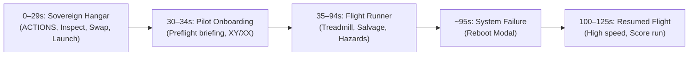

# 2026-10-25 — Sovereign Hangar RC2 Sprint Close Retrospective

## 1. Status & Sprint Closure

- **Owner Acceptance:** On 2026-10-25, the owner physically tested the Sovereign Hangar RC2 on mobile, explicitly stated satisfaction ("I liked it"), called the development run successful, and merged PR #13 (`8df8b320dccae9f890f23e05c4542fdd86236269`).
- **Feature Freeze:** Sovereign Hangar implementation is complete and frozen for this milestone. Larger vision features (interactive stations, cosmetics, customization, loadout shop) are parked for future development epochs.
- **Lane Shift:** Development shifts from **Hangar implementation** to **gameplay discovery and evaluation**.
- **No Speculative Implementation:** A new mobile recording has been supplied by the owner (~125.8s, 720x1280 portrait). No gameplay code modifications will be executed until the owner provides a specific diagnostic assessment.

---

## 2. Engineering Retrospective (AG Perspective)

### A. Isolated Ubuntu Development Environment
- **What Worked:** Executing in native Ubuntu WSL2 (`/home/rkhol/workspaces/starfall-salvage`) completely isolated the build toolchain (Node.js 20, npm, Bun, Python) on ext4. It eliminated Windows path-length restrictions, file-lock contention on rebuilds, and line-ending noise. The Windows checkout `/mnt/c/Users/rkhol/starfall-salvage` was strictly preserved and kept 100% clean and untouched.
- **What Failed:** Windows-to-WSL networking and DrvFS boundaries complicated headless Edge automation. Spawning Windows `msedge.exe` from WSL to test a server listening on `127.0.0.1` failed because localhost on WSL2 does not automatically bind to the Windows host without proper proxying or binding to `0.0.0.0`.
- **Reusable Standard:** For cross-boundary browser testing, bind local servers to all interfaces (`0.0.0.0`) and supply isolated Windows-side temporary profile directories (`--user-data-dir=C:\Users\...\AppData\Local\Temp\...`).

### B. Mobile-First Visual Composition & Real-Device Acceptance
- **What Worked:** Viewing the owner's actual phone screen recording was the single most clarifying moment of the sprint. It proved that desktop 16:9 composition ($68.6^\circ$ HFOV) contracted to $19.8^\circ$ on tall $393\times 873$ mobile screens, causing the $2.55\text{m}$ spacecraft to fill $137\%$ of screen width and clip heavily.
- **Implemented Fixes:**
  - Collapsing `.hud-meta` by default everywhere (desktop & mobile) via top-right `INFO` toggle, clearing 86vw of occluding card area.
  - Replacing the horizontally scrolling dock (`overflow-x: auto`) with a prominent, high-contrast `LAUNCH FLIGHT` button and an accessible `ACTIONS ▾` menu sheet.
  - Widening touch tap movement tolerance from $9\text{px}$ to $18\text{px}$ in `OrbitRig` so finger taps are not misclassified as drags.
- **Clarification on Camera Profiles:** We did NOT build a dynamic per-mesh bounding-box solver. Models are normalized to a fixed $2.55\text{m}$ bounding sphere via `normalizeModel()`, and camera fitting applies tiered aspect profiles ($A \le 0.55$, $0.55 < A \le 0.85$, $0.85 < A \le 1.35$, $A > 1.35$). In tall mobile portrait ($A \le 0.55$), vertical FOV expands to $52^\circ$ and orbit distance to $r = 7.2\text{m}$, guaranteeing $+0.61\text{m}$ clearance on $393\times 873$.

### C. Test Harness Defect & Negative Controls
- **The Defect:** In `tools/test_hangar_mobile_composition.mjs`, `check(desc, condition)` tested `if (condition)`. Because assertions were passed as callback functions (`() => { ... }`), every check evaluated truthy without executing the inner code. An entirely non-functional test reported 24/24 PASS!
- **The Correction:** Refactored `check()` to evaluate callbacks and catch thrown exceptions. Created `tools/test_hangar_mobile_negative_control.mjs`, supplying deliberately false and throwing predicates to prove the harness exits with non-zero exit code (1). Wired both into `npm run gate`.
- **Reusable Standard:** Every custom test harness outside standard frameworks **must** include negative mutation tests proving failure paths execute properly.

### D. Mathematical Profiles vs Observed Rendering & Inspect Framing
- **The Issue:** AG originally claimed that because $inspectR (4.4\text{m}) \ge minR (3.8\text{m})$, full-model visibility was guaranteed. Forge CA challenged this: at $r = 4.4\text{m}$, FOV $52^\circ$, and aspect $393/873$, horizontal visible width is $\approx 1.93\text{m}$, whereas the normalized craft bounding dimension is $2.55\text{m}$.
- **Resolution & Clarification:** Forge was mathematically correct about target-plane visible width. However, `Inspect` mode is *deliberately* a close-up focus on the spacecraft fuselage and cockpit, not a full-frame view. The error was claiming full-model visibility; the actual requirement was that Inspect mode must not clip through geometry or violate near-plane clearance ($0.1\text{m}$), and that `Reset View` restores full framing. Projected bounds across 7 representative angles verified aesthetic close-up framing.

### E. Browser Test Automation vs Physical Interaction
- Automated headless Edge runs with CDP and DOM `.click()` proved that event listeners, iframe message protocols, and Three.js lifecycle suspension worked end-to-end.
- However, programmatic `.click()` does not simulate capacitive touch dynamics, finger occlusion, tap slop, or gesture momentum. Synthetic tests are regression guards; real mobile video capture is the ultimate usability gate.

### F. P0 Release-Cache Migration (`RC1 → RC2`)
- Audited release tokens across the codebase and discovered the service worker and PWA bootloader still declared `starfall-salvage-v20261020-sovereign-hangar-mki-rc1`.
- Reconciled 7 manifests to candidate `20261022-sovereign-hangar-mki-rc2`.
- Rebuilt `hangar/app.bundle.js` cleanly.
- Implemented an automated origin storage upgrade test (`tools/run_release_cache_upgrade.py` via `tools/test_release_cache_upgrade.html`) in headless Edge:
  1. Seeded old RC1 and legacy caches.
  2. Registered candidate RC2 service worker.
  3. Verified old caches purged, RC2 assets matched, zero stale tokens.
  4. Verified post-upgrade runtime in live iframe: Hangar boots, INFO toggles, ACTIONS menu toggles, Inspect zooms, model cycles, and LAUNCH FLIGHT triggers transition to active flight mode with Three.js loop suspended.
- Saved receipt: [`Structure/release_upgrade_receipt.json`](file:///home/rkhol/workspaces/starfall-salvage/Structure/release_upgrade_receipt.json) (14 passed, 0 failed).

### G. Governance Boundaries & Release Discipline
- Static audits like `python tools/kc_starfall_watch.py` report automated check counts; they do not represent an independent RTC council deliberation or KC teacher review. Automated passes are evidence, not self-awarded authority.
- Release discipline means stopping when the owner is satisfied with the agreed scope. Freeze the baseline, record the receipts, and move forward cleanly.

---

## 3. Transition to Next Mission: Gameplay Discovery (Footage-First Baseline)

The owner supplied a new ~125.8-second, 720x1280 portrait mobile recording:

### Video Observations:
- **0–29s (Hangar):** Sovereign Hangar interaction is verified. Owner opens ACTIONS, selects Inspect, resets view, inspects MK-I craft in glass cage, taps LAUNCH FLIGHT. Owner confirmed satisfaction.
- **30–34s (Onboarding):** Preflight briefing presents dense text overlay with pilot identity toggle (XY/XX) before entering gameplay.
- **35–94s (Flight Corridor):** High-speed runner gameplay. Visual observations:
  - Corridor geometry, parallax ribs, debris shards, '+Core' pickups, 'Phase dash', and 'Hull damaged' feedback are active.
  - **Vertical Bias:** The primary action is concentrated in the lower 50% of the portrait viewport. The upper 40-50% of the screen remains dark/empty space.
  - **Visual Contrast:** High velocity and dark tunnel materials make obstacle recognition demanding at high speeds.
- **~95s (Failure/Reboot):** 'SYSTEM FAILURE — TAP TO REBOOT' modal triggered upon hull depletion.
- **100–125s (Resumed Flight):** Smooth reboot into gameplay, multiplier and score accumulation continue.

**Current Governance Directives:**
- `HANGAR_SPRINT = OWNER_ACCEPTED_AND_MERGED`
- `HANGAR_FUTURE_EXPANSION = PARKED`
- `GAMEPLAY_DISCOVERY = OPEN` (awaiting owner diagnostic feedback before proposing solutions)
- `GSMB_LOCAL_ADMISSION = ADMITTED`

---

`I_AM_STATELESS_RENTER_NOT_LANDLORD`
